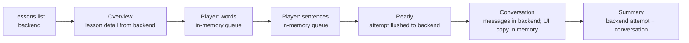

# Zubaan frontend overview

This describes the frontend as implemented today. Important claims name the
file that demonstrates them.

## 1. Stack, running it, and folder map

Zubaan is a Next.js 16 App Router application using TypeScript, React 19,
Tailwind v4, Radix/shadcn UI, lucide-react, torph, Sonner, and web-haptics.
The fixed stack and visual constraints are in [`DESIGN.md`](../DESIGN.md);
the dependency list is in [`package.json`](../package.json).

```bash
npm install
npm run dev
```

The browser expects `NEXT_PUBLIC_API_URL` (otherwise
`http://localhost:5000`), and optionally `NEXT_PUBLIC_TTS_PROVIDER` (`kokoro`
by default, or `sarvam`). These defaults are in
[`src/lib/api/client.ts`](../src/lib/api/client.ts) and
[`src/lib/config.ts`](../src/lib/config.ts).

| Area | Contents |
|---|---|
| `src/app/` | App Router pages and the root, app, and focus layouts |
| `src/components/` | Shared UI, navigation, hints, speech feedback, and exercise components |
| `src/hooks/` | API loading, user identity, WAV recording, and audio playback |
| `src/lib/` | API boundary, types, pure lesson/speech/score logic, haptics, and error copy |
| `public/` | Static assets |
| `docs/` | Design, API index/slices, lesson content, and this overview |

## 2. Route map

The app layout is `src/app/(app)/layout.tsx` plus
`src/app/(app)/app-client-layout.tsx`: it applies `AuthGuard`, the phone-width
main column, and the bottom `NavIsland`. The focus layout is
`src/app/(focus)/layout.tsx`: it applies `AuthGuard` but no navigation island.
The root layout supplies fonts, dark mode, metadata, and the toast host
(`src/app/layout.tsx`).

| Route | Layout | API calls made by the route |
|---|---|---|
| `/` | root only | None; redirects to `/home` or `/onboarding` from `src/app/page.tsx` |
| `/onboarding` | root only | `onboard` on submit |
| `/home` | app | `home` |
| `/lessons` | app | `lessons` |
| `/lessons/[id]` | app | `lesson`; optional `startConversation` for “Skip to conversation” |
| `/lessons/[id]/play` | focus | `lesson`, `startAttempt`, queued `recordResult`, `completeAttempt`, `startConversation` |
| `/conversation/[id]` | focus | `conversation`, `lesson`, `takeTurn`, `stt`, `endConversation` |
| `/conversation/[id]/summary` | focus | `conversation`, `lesson`, optional `attempt`; `startConversation` for chat again |
| `/mistakes` | app | `mistakeSummary`, paginated `mistakes`, and `tts` for corrected phrases |
| `/voice-lab` | app | `tts` and `stt` |

The route pages are thin parameter/data-loading wrappers; the behavior lives
in the matching `*-client.tsx` files. The complete route tree is visible under
[`src/app/`](../src/app/).

## 3. Lesson flow



The list and overview are fetched from the backend. The player fetches lesson
content and keeps phase, queue, answers, results, streaks, and retry state only
in React state (`src/app/(focus)/lessons/[id]/play/play-client.tsx`). Results
are asynchronously recorded to the backend attempt, but player state is not
stored in localStorage. Reloading or leaving the player loses its visible
progress and starts no resumable player session; the backend may retain partial
results.

The conversation is identified by its URL id and reloaded from the backend.
New messages are first rendered in local state and then persisted by
`takeTurn`. A reload loses only transient pending UI state, not completed
server messages. The summary reads the saved conversation and attempt, so it
does not depend on the previous React tree
(`src/app/(focus)/conversation/[id]/summary/summary-client.tsx`).

## 4. The player

### State machine and sync

`LessonPlayer` phases are `intro -> exercise -> review? -> stage-done ->
intro` for the next stage, then `ready`
(`src/app/(focus)/lessons/[id]/play/play-client.tsx`). Each stage starts with
a queue. A wrong retryable item is inserted at least three positions later;
items that cannot be retried in-place go to the review queue. Retried items do
not change first-try results or the streak.

The player creates an attempt on mount. Each settled exercise is serialized
through `createAttemptSync` so results keep request order. Before conversation
it flushes the queue, completes the attempt with `bestStreak`, and passes the
attempt id when possible. A sync failure is logged and the conversation can
still start without the attempt link
(`src/lib/attempt-sync.ts`, `play-client.tsx`).

The streak increments for correct/said/close first attempts, resets on wrong,
and is unchanged by skips and retries. Milestones are 3, 5, 8, and 12; the
best streak is sent to the backend. These rules are pure functions in
[`src/lib/lesson-player.ts`](../src/lib/lesson-player.ts).

### Exercises and results

| Component | Interaction | Result reported |
|---|---|---|
| `McqExercise` | Select one shuffled option; number keys 1–4 also select | `correct` or `wrong` via `isCorrect` |
| `GapExercise` | Select the missing word | `correct` or `wrong` |
| `ListenPickExercise` | Hear TTS, optionally slow, then select | `correct` or `wrong` |
| `OrderWordsExercise` | Tap shuffled tiles; tap selected tiles to remove | Array is compared to the normalized answer |
| `MatchPairsExercise` | Match English and Hindi columns | Reports success only if every pair is matched with no mistake |
| `SpeakExercise` | Listen/slow, record, or skip a target sentence | `said`, `close`, `missed`, or skipped |

`ExerciseView` in `play-client.tsx` maps API exercise types to these
components. `isCorrect`, `buildQueue`, `scheduleRetry`, `streakAfter`,
`streakMilestone`, `stageStats`, `shuffle`, `shuffleColumns`, `buildTiles`,
and `normalizeWord` are the pure player helpers. `isCorrect` uses exact
strings for MCQ/gap/listen-pick and normalized word order for order-words;
there is no client answer check for match-pairs or speech.

## 5. Conversation screen

The screen loads the conversation and its lesson
(`src/app/(focus)/conversation/[id]/conversation-client.tsx`). A turn works as
follows:

1. The learner types a trimmed message, or records speech.
2. Voice is converted to a 16 kHz mono WAV, sent to STT as `en-IN`, and its
   transcript is rejected if it is empty or non-Latin.
3. The text is sent to `takeTurn`.
4. The response adds the learner message with any correction and the AI reply
   with its optional audio URL; reply audio plays from that URL.
5. A correction fires a nudge; a clean turn fires success. The backend can end
   the conversation when its turn limit is reached, or the learner can press
   End (`conversation-view.tsx`).

The hint panel reads `lesson.chat.turns[hintIndex].hint` and maps that turn's
`sentenceId` to the lesson sentence with `turnSentence`
(`src/components/hint-panel.tsx`, `src/lib/lesson-helpers.ts`). It initially
shows the hint in English and Hindi; Show sentence reveals the target and TTS
controls. Outcomes and corrections come from backend `ConversationMessage`
fields and appear in message bubbles and the summary
(`src/app/(focus)/conversation/[id]/conversation-view.tsx`).

## 6. Summary and score

The summary fetches the conversation, lesson, and linked attempt. Its numbers
come from `src/lib/lesson-score.ts` and
[`src/app/(focus)/conversation/[id]/summary/summary-client.tsx`](../src/app/(focus)/conversation/[id]/summary/summary-client.tsx).

| Display | Source/calculation |
|---|---|
| Overall score | Weighted available components: words 14%, sentences 25%, speaking 21%, conversation 40%; weights are renormalized when a component is absent |
| Words/sentences | Correct first recorded result divided by non-speech exercises in that stage |
| Speaking | `said` = 1, `close` = 0.6, other outcomes = 0 |
| Conversation | Exact phrase = 1, close = 0.7, other = 0 |
| Phrases said | Conversation user messages whose outcome is `exact` |
| First try | Non-speech attempt results with `correct` / total non-speech exercises |
| Skipped | Speech results marked `skipped` plus conversation outcomes `moved_on` |
| Best streak | `attempt.bestStreak` returned by the backend |
| Corrections | Attempt mistakes plus conversation messages with a correction |

Conversation-only sessions have no attempt; their exercise components and first
try/best-streak display as unavailable, while the conversation component still
contributes to the score.

## 7. Speech on the client

`useWavRecorder` requests the microphone with echo cancellation, noise
suppression, and auto gain control. It records through `MediaRecorder`, converts
to 16 kHz mono WAV, caps recording at 25 seconds, and rejects recordings under
0.4 seconds or with peak amplitude below 0.03. That peak check is the silent-mic
guard (`src/hooks/use-wav-recorder.ts`); microphone permission/device errors are
shown through `notifyError`.

`PhrasePractice` sends every practice recording to STT with `language:
"en-IN"`, rejects non-Latin transcripts, and runs the transcript through
`matchSpeech`. It renders per-word match/close/missed feedback, the heard text,
and a said/close/missed verdict
(`src/components/phrase-practice.tsx`, `src/lib/speech-match.ts`).

Conversation voice input also sends `en-IN`; Voice Lab exposes Auto, English,
Hindi, Tamil, and Telugu plus STT modes
(`src/app/(focus)/conversation/[id]/conversation-view.tsx`,
`src/app/(app)/voice-lab/stt-panel.tsx`). TTS is requested as `en-IN` and uses
the configured provider in `usePhrasePlayer` and `src/app/(app)/voice-lab/tts-panel.tsx`.

## 8. Shared systems

**API and errors.** [`src/lib/api/client.ts`](../src/lib/api/client.ts) is the
only backend boundary. Authenticated requests read `zubaan:userId` and send it
as `x-user-id`; JSON gets a content type and multipart audio lets the browser
set its boundary. Fetch/network failures become `ApiError`; `describeError`
maps status 0, 401, 409, 429, 502, and 504 to user-facing copy. `useApi`
handles loading/reload and clears a matching local session on 401.

**Haptics and sounds.** `src/lib/haptics.ts` maps tap/select/success/nudge/error
to web-haptics, falling back to sound where vibration is unavailable. The
sound preference is localStorage-backed and toggled on Home. `notifyError`
always combines an error toast with an error haptic
(`src/lib/notify.ts`).

**Design rules in 10 lines.**

1. Dark-only, calm, phone-width, content-first UI.
2. Use background/card/muted tokens and low-contrast borders, not shadows.
3. Indigo is the action accent; semantic colors stay small and paired with text/icons.
4. Use Geist, with Noto fallbacks for supported Indian scripts.
5. Keep sentence case, short copy, and roughly 60-character lines.
6. Use rounded pills for buttons/nav and rounded-2xl cards/inputs/bubbles.
7. Keep bottom navigation fixed except on conversation focus screens.
8. Motion is brief, user-triggered, transform/opacity-only, and reduced-motion safe.
9. Use Button, Card, Input/Textarea, Skeleton, Sonner, and lucide conventions.
10. Preserve keyboard focus, 40px touch targets, readable contrast, and non-color speech cues.

These rules are summarized from [`DESIGN.md`](../DESIGN.md).

## 9. State and persistence

| State | Where it lives | Reload behavior |
|---|---|---|
| User id | `localStorage` key `zubaan:userId` | Persists until Start over/session clear |
| Native language | `localStorage` key `zubaan:nativeLanguage` | Persists with the user id |
| Sound preference | `localStorage` key `zubaan:sounds` | Persists; defaults on non-vibrating devices |
| Route id | URL | Persists only while the URL is retained |
| Lists/detail/summary data | React state from API | Fetched again |
| Player queue, answers, feedback, streak | React state/refs | Lost; player restarts and may create a new attempt |
| Conversation completed messages | Backend, fetched by conversation id | Restored |
| Pending typed/voice UI and local audio | React state/object URLs | Lost |
| Attempts/results/conversation turns | Backend | Available when linked by backend ids |

The browser identifies the learner by the `x-user-id` request header, sourced
from localStorage (`src/lib/api/client.ts`). Two tabs share the same user id
and sound setting, but do not share React state. A logout/start-over in one tab
dispatches a local session event in that tab and a storage event in the other;
simultaneous player tabs can create independent attempts, and simultaneous
conversation submissions can race against the same backend conversation.

## 10. SUSPECTED HOLES

1. **Player progress is not resumable** — `src/app/(focus)/lessons/[id]/play/play-client.tsx`; leaving or reloading loses queue, answers, and visible progress even if partial results reached the backend. Rough size: medium.
2. **Client and backend scoring can drift** — `src/lib/lesson-score.ts`, `src/lib/summary-score.ts`, and `src/lib/speech-match.ts`; score/phrase interpretation is duplicated outside the backend contract. Rough size: medium.
3. **English/Hindi are hard-coded in interaction copy and fields** — `src/components/hint-panel.tsx`, `src/app/(focus)/conversation/[id]/conversation-view.tsx`, and `src/app/(focus)/lessons/[id]/play/play-client.tsx`; expanding UI language or hint language needs broad copy/data changes. Rough size: medium.
4. **Speech language is fixed for core practice** — `src/components/phrase-practice.tsx` and `src/app/(focus)/conversation/[id]/conversation-view.tsx`; onboarding language is not used to select STT/TTS language, blocking real multilingual practice. Rough size: medium.
5. **Script/font coverage is incomplete** — `src/app/layout.tsx` loads Noto Devanagari, Tamil, and Telugu while onboarding offers ten languages. Other hint scripts may fall back poorly. Rough size: small/medium.
6. **Accessibility has gaps in complex controls** — `src/components/exercises/match-pairs-exercise.tsx`, `src/components/exercises/order-words-exercise.tsx`, and speech feedback components; keyboard semantics and announcements for matching, retries, and verdict changes are not consistently explicit. Rough size: medium.
7. **Conversation and voice screens are heavy client surfaces** — `src/app/(focus)/conversation/[id]/conversation-view.tsx` and `src/components/phrase-practice.tsx`; they hold the full transcript, audio state, recorder, and speech feedback in one client tree. Rough size: medium.
8. **Offline behavior is absent** — `src/lib/api/client.ts` and `src/hooks/use-api.ts`; failed network requests show errors, but there is no queue, cache, or offline recovery for attempts, turns, or audio. Rough size: large.
9. **Attempt sync is best-effort** — `src/lib/attempt-sync.ts` and `play-client.tsx`; failures are warned and the conversation can proceed without the attempt, producing a conversation-only summary. Rough size: small/medium.
10. **Concurrent-tab coordination is absent** — `src/lib/api/client.ts` and player/conversation clients; shared identity with independent in-memory workflows can produce duplicate attempts or racing turns. Rough size: medium.

## 11. NOT IMPLEMENTED

- Resuming a player after reload, navigation away, or browser recovery.
- Offline lesson, attempt, conversation, or speech support.
- Cross-tab locking or workflow synchronization.
- Client-side persistence of drafts, recorder results, or pending API mutations.
- A user-selectable practice language wired through core STT/TTS.
- Full font/script coverage for every onboarding language.
- Pronunciation scoring; speech matching is transcript word matching, not acoustic pronunciation analysis.
- A client route for backend health/status.
- A visible retry queue or durable recovery UI for failed attempt synchronization.
- Native authentication beyond the local `x-user-id` session identifier.
